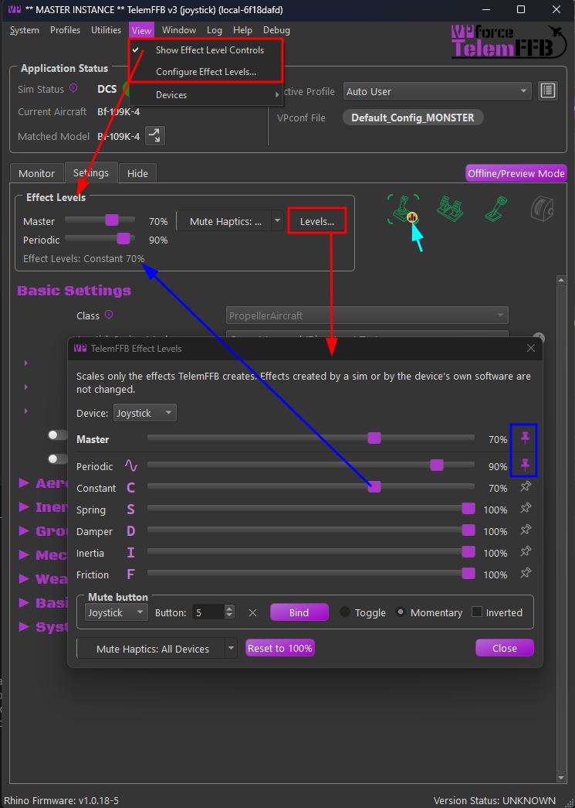
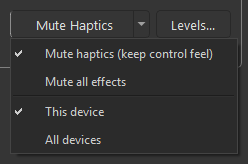
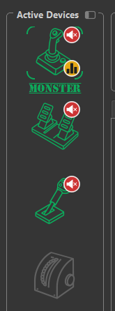

# Effect Levels & Mute

The effect levels can be used to scale every effect TelemFFB creates by effect type.  The levels are available per device. A configurable mute control is available which can silence the effects temporarily.  The mute is bindable to a button or switch for quick or emergency access.

Use the levels to tone down a device as a whole, or one kind of effect, without touching the per-effect sliders of every aircraft.

The controls do not start any effects on their own.  They are only used to adjust the global gain per effect type for all of the various effects that TelemFFB creates.

{ width="700px" }

## The Levels

Each standard FFB effect type has a gain control.  The Master value is applied last and will further scale any values applied to other effect types.

- **Master** - scales every effect on the device.
- **Periodic** - vibration and rumble effects.
- **Constant** - steady pushes: control weight, elevator droop, G-force and AoA.
- **Spring** - centering and position-holding springs, including trim and autopilot following.
- **Damper** - resistance that grows with stick speed.
- **Inertia** - resistance to changes in stick speed.
- **Friction** - steady drag against stick movement.

Example: With Master at 50% and Periodic at 50%, vibrations effects will play at 25% of the strength configured in a given effects settings value.

The level settings are stored in the registry per device role and persist across restarts.

## The Effect Levels Box

On the master instance, the Settings tab has an **Effect Levels** box above the settings list. It shows the pinned level sliders for the device in scope, the mute button, and a **Levels...** button which opens the [Effect Levels dialog](#the-effect-levels-dialog).

A line under the sliders lists any level below 100% whose slider is not pinned.

## The Effect Levels Dialog

- **Device** - which device the sliders belong to. The selector shows only when more than one device is configured.
- **Sliders** - one per level. Changing a slider value applies immediately.
- **Pins** - Press the pin button to anchor that setting in the Effect Levels box or to remove it.
- **Reset to 100%** - sets every level of the selected device back to 100%.
- **Mute** - the same mute button as in the box, for the selected device.
- **Mute button** group - binds a hardware button to the mute; see [Binding a Button to the Mute](#binding-a-button-to-the-mute).

## Mute

The mute button has two parts. Click the main part to mute the device or release it. Click the arrow to choose what the button does:

{ width="420px" }

- **Mute haptics (keep control feel)** - silences the vibrations and the constant forces. Any spring, damper, inertia or friction effects are unaffected during the mute.
- **Mute all effects** - Mutes every effect generated by TelemFFB while the mute is active.
- **This device** or **All devices** - whether the button mutes the device the binding belongs to, or every device.

A muted effect is not stopped or destroyed.  Rather, its intensity is dropped to 0 for the duration of the mute.  Un-muting restores any active effects immediately.

### Muting every device

**Mute All Devices** in the **Utilities** menu mutes every configured device, the same as the mute button with **All devices** selected. The item is checkable, so the menu shows whether the mute is active. A mute of all devices lasts until it is released for all devices, or until you release any one device by hand.

## Binding a Button to the Mute

The **Mute button** group in the Effect Levels dialog binds a button on a device to the mute. The button performs whatever the mute button is set to, mode and scope included.

- **Device** - the device whose mute the button controls.
- **Button** - the button number on that device. Click **Bind**, then press a button on any device within five seconds. A button on a game controller, or on another FFB device, is stored with the device's name; see [Button Devices](configuration.md#button-devices-tab). Click **✕** to clear the binding.
- **Toggle** - each press mutes or releases.
- **Momentary** - muted while the button is held.
- **Inverted** - for Momentary: muted while the button is released. Hold the button to let the effects through. The device starts muted on each TelemFFB start, until the first press. Losing the device counts as releasing the button.

## Status Icons

- **Muted** - A device icon shows a red mute badge while the device is muted.
- **Effect adjustment active** - An amber bar-chart badge while any of the devices level's are configured below 100%. Hover your mouse over the icon and the tooltip will list the levels below 100%.

{ width="165px" }
